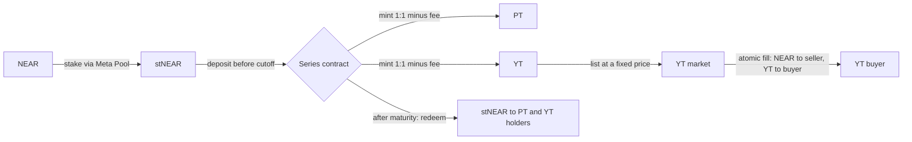

<p align="center">
  
</p>

<h1 align="center">YieldForge</h1>

<p align="center">
  <strong>Split NEAR staking yield from principal. Lock in a fixed return, or buy the yield.</strong><br />
  Yield tokenization for Meta Pool stNEAR on NEAR Protocol, with a fixed-price market for the yield.
</p>

<p align="center">
  
  
  
  
  <br />
  
  
  
  
  
  
  <br />
  
  
  
</p>

<p align="center">
  <a href="https://yieldforge.mdloglabs.org"><strong>Live demo</strong></a> ·
  <a href="https://youtu.be/7dZhm4mILFo"><strong>Demo video</strong></a> ·
  <a href="https://yieldforge.mdloglabs.org/docs">In-app docs</a> ·
  <a href="#try-it-judge-walkthrough">Try it</a> ·
  <a href="#deployed-contracts-near-testnet">Contracts</a> ·
  <a href="#near-hackathon">NEAR HACKATHON</a>
</p>

---

## Table of contents

- [Overview](#overview)
- [How it works](#how-it-works)
- [Try it (judge walkthrough)](#try-it-judge-walkthrough)
- [Features](#features)
- [How NEAR is used](#how-near-is-used)
- [From any chain (NEAR Intents)](#from-any-chain-near-intents)
- [Deployed contracts (NEAR testnet)](#deployed-contracts-near-testnet)
- [Architecture](#architecture)
- [Tech stack](#tech-stack)
- [Getting started](#getting-started)
- [Configuration](#configuration)
- [Security model and limitations](#security-model-and-limitations)
- [NEAR HACKATHON](#near-hackathon)
- [License](#license)

## Overview

**The problem.** Staking NEAR through Meta Pool gives you stNEAR, whose NEAR value grows as staking rewards accrue. That growth is
bundled with the principal: you cannot sell next quarter's yield today, and you cannot buy exposure to staking yield without
buying (and locking) the principal too.

**The product.** YieldForge splits stNEAR into two tokens per series:

| Token | Claim at maturity | Who wants it |
| --- | --- | --- |
| **PT** (principal token) | `min(R0, RT) / RT` stNEAR per PT, worth R0 NEAR when the rate rose | Holders who want a fixed return |
| **YT** (yield token, NEP-141) | `max(RT − R0, 0) / RT` stNEAR per YT, worth RT − R0 NEAR | Traders who want leveraged staking yield |

`R0` is the stNEAR→NEAR rate at the deposit cutoff and `RT` the rate at maturity, both read on-chain from Meta Pool. One PT plus one
YT always redeems for exactly one stNEAR, so a series can never owe more than it holds. YT trades on a built-in fixed-price market:
sellers lock in a return up front, buyers pay a small price for all the yield on the full principal.

## How it works



1. **Stake.** NEAR becomes Meta Pool stNEAR (`deposit_and_stake`).
2. **Split.** A deposit (`ft_transfer_call` on stNEAR) mints equal PT and YT, minus a deposit fee sized to the tenor (~1 % a year).
3. **Trade.** YT is listed at a fixed price and escrowed by the contract; `buy` pays the seller and delivers YT in one call.
4. **Settle.** After the cutoff anyone calls `capture_baseline` (records R0); after maturity anyone calls `request_settlement`
   (records RT). Holders then burn PT/YT for stNEAR. There is no deadline and no queue.

Series run as a ladder of tenors (7, 30 and 90 days). A new series opens its deposit window before the previous one of the same
tenor closes, so there is always somewhere to deposit. For judging there is also a one-day series, `stnear-1d-01`, that settles
on 2026-11-17, so the whole lifecycle can be checked during the judging window.

## Try it (judge walkthrough)

**Live demo:** https://yieldforge.mdloglabs.org (NEAR testnet, live contracts). Every number on screen is read from
the chain on page load.

**Demo video (2 min):** https://youtu.be/7dZhm4mILFo. It shows one stake-and-deposit, a listing and a second account's
purchase as real testnet transactions; the explorer links are in the video description.

### A. Without a wallet (about 2 minutes)

| Do | See |
| --- | --- |
| Open the live demo | The hero card shows the series whose deposit window closes first, with the live stNEAR rate; the strip below shows value locked, the **collateral ratio (100 %)**, filled YT volume and open listings, summed over every series |
| Scroll to **Simulator**, switch the **7D / 30D / 90D** tabs, move the APR slider | Seller's fixed APR and the buyer's profit, break-even APR and principal exposure recompute from each series' live R0, fees and days left |
| Scroll to **The live series** | One card per series with its phase, cutoff, maturity, R0, value locked and a lifecycle stepper |
| Open **Docs → Deployments** (`/docs#deployments`) | Every series contract with phase, dates, R0, fee, YT symbol (`ft_metadata`) and whether its code is still upgradeable (`view_access_key_list`) |
| Click **Launch app → Buy YT** | All open YT listings of every series in one table, each with its **break-even APR** |

### B. With a NEAR testnet wallet (about 5 minutes)

Prerequisite: a NEAR testnet account in [Meteor Wallet](https://wallet.meteorwallet.app) (browser extension or web; **Connect
wallet** signs in with Meteor, and MyNearWallet and HOT are only fallbacks) with ~3 testnet NEAR, free from the
[NEAR faucet](https://docs.near.org/getting-started/faucet).

| Do | See |
| --- | --- |
| **Connect wallet** (top right), open **Deposit & sell** | Your NEAR, stNEAR, PT and YT balances, and the series that are open for deposits |
| Step **1 · Get stNEAR**: pick an open series, enter 1 NEAR, keep **Also deposit it into …** ticked, tick the risk box, **Stake & deposit** | One transaction with two actions (`deposit_and_stake` + `ft_transfer_call`), one signature; PT and YT appear in **Your wallet** (about 0.31 each, 1 stNEAR ≈ 3.2 NEAR on testnet) and the flow moves to step 3. Untick the box to only stake, then deposit in step 2 |
| Step **3 · Sell your YT**: click **Use** (fair price at Meta Pool's current staking APR, about 3.8 %), choose how long the listing stays open, **List YT for sale** | The page shows the fixed APR you lock in; the listing appears on **Buy YT** |
| From a **second account**: **Buy YT → Buy** | The YT shows in that account's **Portfolio**; the seller receives the NEAR in the same transaction (check the explorer link) |
| Lifecycle, on **`stnear-1d-01`**: buy its YT on **Buy YT** (a listing is open until 2026-11-19), then after **2026-11-17 06:00 UTC** open **Portfolio** with that series selected, **Enable stNEAR payouts** if asked, and **Redeem YT** | The hosted keeper records R0 at the cutoff (2026-11-16 06:00 UTC) and RT at maturity, usually within 10 minutes; both show under **Docs → Rates**. Redemption pays stNEAR (YT pays 0 while the testnet stNEAR rate is flat, PT pays 1 stNEAR per unit). **Capture baseline** / **Request settlement** buttons appear in Portfolio if the keeper has not run yet |

### D. From any chain (NEAR Intents, no wallet needed for the preview)

| Do | See |
| --- | --- |
| Open **From any chain** in the sidebar (`/any-chain`) | Three tabs: **Deposit** (any asset → PT + YT), **Buy YT** (pay from any chain), **Cash out** (stNEAR → any chain) |
| **Deposit**: pick a chain and asset (e.g. Arbitrum · USDC), enter 25 | A live 1Click quote: stNEAR out, the PT + YT you would mint after the series fee, worst case at 1 % slippage, time estimate |
| **Buy YT**: pick a listing, then pay with e.g. Bitcoin · BTC | The exact BTC amount that buys that much YT, including the market fee, YT registration and gas |
| **Cash out**: enter 2 stNEAR, receive Solana · USDC | What arrives on Solana for your stNEAR |

On the testnet demo these are **dry quotes against mainnet liquidity**: nothing is reserved or sent, and the send buttons read
"mainnet only", because NEAR Intents settles on mainnet only (Q-007). The mainnet build (`npm run build:mainnet`) turns them on.

### C. Verify on-chain

```sh
# Series state (terms, phase, R0/RT, supplies, fees)
npx near-cli view stnear-90d-02.solidnecktie5405.testnet get_series '{}' --networkId testnet
# Listings of a series
npx near-cli view stnear-7d-02.solidnecktie5405.testnet get_listings '{}' --networkId testnet
```

Or browse the accounts on [NearBlocks testnet](https://testnet.nearblocks.io/address/stnear-90d-02.solidnecktie5405.testnet).

## Features

**Protocol (Rust contract, one account per series)**
- stNEAR vault with PT ledger and YT as a standard NEP-141 token (NEP-145 storage, NEP-148 metadata, NEP-297 events)
- Fixed-price YT market: escrowed listings, partial fills, atomic `buy` (seller paid and excess refunded in the same call)
- Permissionless lifecycle: `capture_baseline` and `request_settlement`, rates read from Meta Pool via cross-contract calls
- Burn-then-pay redemption; a failed stNEAR transfer restores the burned claim
- Narrow admin: pause blocks deposits, listings and fills only; deposit fees are withdrawable, user collateral is not
- Deposits can name a receiver (`msg: {"receiver_id": …}`) and a series can carry a deposit cap; both exist for the NEAR
  Intents flows
- 47 unit tests (`contracts/series/src/tests.rs`)

**App (React)**
- Landing page with live protocol metrics, multi-series simulator and series ladder
- **Deposit & sell** guided flow: stake NEAR → deposit stNEAR → list YT, on one page. Stake and deposit can go in **one
  transaction** (two actions on the stNEAR contract: if it fails nothing is staked; if the series refuses the deposit, the
  app reports it and the new stNEAR stays in the wallet)
- **Real staking APR**: Meta Pool's 30-day stNEAR growth on mainnet, read from archival RPC, prices YT instead of a fixed
  assumption; the testnet rate is measured too, and the app warns when it is flat
- Sellers see the **fixed APR they lock in** at their price; buyers see each listing's break-even APR against today's
- **Buy YT**: every listing that can be filled now across series (expired listings and paused series left out), with
  price and break-even APR
- Portfolio across all series: balances, **projected payout at maturity** (exact once settled), listings (cancel),
  baseline/settlement calls, exact redemption preview
- In-app docs with live deployment data, contract reference and risks
- **From any chain** (NEAR Intents 1Click): deposit from 25+ chains straight into PT + YT, buy YT with assets held on
  another chain, and cash stNEAR out to any chain, with a step-by-step funds tracker (see below)
- Demo mode with labelled simulated data when `VITE_NEAR_LIVE` is not `true`

**Operations (Node scripts)**
- `deploy-series.mjs`: create a sub-account, deploy and initialize a series in one atomic transaction
- `roll-series.mjs`: deploy the next series of a tenor and add it to the app configuration
- `keeper.mjs`: one pass that captures R0 and requests settlement for every due series; runs every 10 minutes as a Railway
  cron job with its own low-balance account (`create-keeper.mjs`)

## How NEAR is used

- **Liquid staking as the yield source.** Meta Pool's stNEAR (`meta-v2.pool.testnet`) is the underlying; its on-chain
  `get_st_near_price` is the only rate oracle. R0 and RT are captured with cross-contract calls and callbacks.
- **Token standards.** Deposits use NEP-141 `ft_transfer_call` into the series, so transfer and mint happen in one flow. YT is a
  NEP-141 token any wallet or contract can hold and transfer.
- **Named sub-accounts as series.** Each series is its own account (`stnear-7d-02.solidnecktie5405.testnet`), which makes the
  tenor ladder easy to deploy, inspect and retire.
- **Cheap, fast finality.** Listings worth a few thousandths of a NEAR fill in one transaction, which keeps short 7-day series
  practical.
- **NEAR Intents (1Click API).** Users on other chains reach YieldForge without a bridge UI: 1Click quotes the route, a
  solver fills it on `intents.near`, and the stNEAR or NEAR is delivered on NEAR. For deposits, 1Click's `customRecipientMsg`
  makes the delivery an `ft_transfer_call` into the series itself. Mainnet only.
- **Wallets.** NEAR Wallet Selector: **Connect wallet** signs in with Meteor Wallet, with MyNearWallet and HOT as fallbacks if
  Meteor cannot load; users sign every transaction themselves.

## From any chain (NEAR Intents)

Staking yield on NEAR is easy to reach for people who already hold NEAR. The `/any-chain` page opens it to everyone else.
It calls the [1Click API](https://docs.near-intents.org/near-intents/integration/distribution-channels/1click-api) straight from
the browser (no backend, no API key; 1Click adds its 0.2 % fee, which every quote already includes).

| Flow | What the user does | What happens |
| --- | --- | --- |
| **Deposit** | Sends e.g. 25 USDC on Arbitrum to a one-time deposit address | A solver swaps it to stNEAR. **Express:** NEAR Intents delivers it with `ft_transfer_call` to the series, with `msg` `{"receiver_id":"<user>.near"}`, and the series mints PT + YT to the user. No NEAR transaction needed. **Standard:** the stNEAR lands in the user's wallet and they sign the deposit. |
| **Buy YT** | Picks a listing, sends BTC/ETH/SOL/USDC | An `EXACT_OUTPUT` quote delivers exactly the NEAR the purchase needs (price + 0.25 % fee + one-time YT registration + gas) as wNEAR; the app unwraps it (`near_withdraw`) and the user signs `buy`. |
| **Cash out** | Sends stNEAR (redemptions) or NEAR (YT sale proceeds) to any chain | One NEAR transaction. stNEAR: `storage_deposit` for the deposit address on `meta-pool.near`, then `ft_transfer`. NEAR: on `wrap.near`, register the wallet, `near_deposit`, register the deposit address, `ft_transfer`. 1Click swaps and pays out on the destination chain; refunds come back to the NEAR wallet. |

Every swap gets a **funds tracker**: quote → sent → swapping on NEAR Intents → arrived on NEAR → deposited / bought / delivered,
polled from `/v0/status`, kept in the browser across reloads, with links to the origin transaction and the
[NEAR Intents explorer](https://explorer.near-intents.org). A refund or failure says so plainly.

**Safety rules in the app.**
- Express is only offered when the series will certainly accept the stNEAR: deposits stay open at least two hours past three
  times the quoted time estimate, the deposit cap has room for the quoted amount + 1 %, the worst-case output clears the
  minimum, and the series is not paused. The check runs again on the real quote. Otherwise the app uses Standard.
- If a routed delivery is refused anyway (the cap filled meanwhile, the cutoff passed during a slow swap), the series does
  **not** bounce it: a bounce would return the stNEAR to the NEAR Intents account that delivered it, not to the user. It keeps
  it for the `receiver_id` instead (`deposit_refunded` event) and the user withdraws it with `claim_refund` (Portfolio and the
  deposit tracker show a Claim button, registering the account on stNEAR first if needed). Routed dust under 0.01 stNEAR is
  refused outright so nobody can fill the series' storage with refund records.
- **Before Express goes public on mainnet** it needs one live test of a few dollars: NEAR Intents forwards `ft_transfer_call`
  with 50 Tgas by default and Meta Pool passes about 8 Tgas of that to `ft_on_transfer`, which uses about 2.4 Tgas on testnet.
  The margin looks sufficient, but it has to be seen on mainnet. 1Click marks `customRecipientMsg` experimental.
- Cash-outs use a plain `ft_transfer`, never `ft_transfer_call`, because the deposit address is an implicit account with no contract.
- Mainnet series carry a **deposit cap** (`--cap`, required by `deploy-series.mjs` on mainnet) to limit exposure of unaudited code,
  and a **minimum deposit** of 1 stNEAR by default (`--min-deposit`), because the series pays each new depositor's storage.
- The deposit tab compares the **round-trip cost** (this quote's entry cost, about the same again to cash out, plus the deposit
  fee) with what one term earns at today's APR, and warns when the trip costs more.

**Honest caveats.** The fixed rate a YT sale locks in is a stNEAR-to-NEAR return. A user who arrives with USDC holds NEAR price
exposure until they cash out; the page says so before anything is sent. Swaps cost the 1Click fee plus the solver spread and
origin-chain gas, each way: on a 7- or 30-day term a small position can lose more on the round trip than the term pays. The
cross-chain path makes sense for larger amounts, for several terms in a row, or for someone who wants NEAR exposure anyway.

**Status.** The flows, the v3 contract (receiver message + cap) and the mainnet build are in this repository and tested
(contract unit tests, `tests/intents-flows.test.mjs`, live dry quotes). The mainnet series are **not deployed yet**. Until they
are, the testnet demo shows live dry quotes only.

## Deployed contracts (NEAR testnet)

All series run the same wasm (code hash `BuYCYcKZ8JxwfX49pPuCNUZTJLW52SbCkHmuRcXzPN7z`). Deposit fees are sized to about 1 % a year;
the market fee is 0.25 %, paid by the buyer.

| Series account | Deposits close (UTC) | Maturity (UTC) | Deposit fee |
| --- | --- | --- | --- |
| [`stnear-1d-01.solidnecktie5405.testnet`](https://testnet.nearblocks.io/address/stnear-1d-01.solidnecktie5405.testnet) | 2026-11-16 06:00 | 2026-11-17 06:00 | 0.01 % |
| [`stnear-7d-01.solidnecktie5405.testnet`](https://testnet.nearblocks.io/address/stnear-7d-01.solidnecktie5405.testnet) | 2026-11-13 00:00 | 2026-11-20 00:00 | 0.02 % |
| [`stnear-7d-02.solidnecktie5405.testnet`](https://testnet.nearblocks.io/address/stnear-7d-02.solidnecktie5405.testnet) | 2026-11-20 00:00 | 2026-11-27 00:00 | 0.02 % |
| [`stnear-30d-01.solidnecktie5405.testnet`](https://testnet.nearblocks.io/address/stnear-30d-01.solidnecktie5405.testnet) | 2026-11-14 00:00 | 2026-12-14 00:00 | 0.08 % |
| [`stnear-90d-02.solidnecktie5405.testnet`](https://testnet.nearblocks.io/address/stnear-90d-02.solidnecktie5405.testnet) | 2026-11-11 00:00 | 2027-02-09 00:00 | 0.25 % |

Underlying: Meta Pool stNEAR, [`meta-v2.pool.testnet`](https://testnet.nearblocks.io/address/meta-v2.pool.testnet).

## Architecture

```
.
├── yieldforge/                 # Frontend (React 19 + Vite 6 + TypeScript)
│   ├── src/pages/              # Landing, Docs, Deposit & sell (EarnPage), Buy YT, Listing, Portfolio, Series, …
│   ├── src/hooks/              # Chain reads: useAllSeries, useSeriesDisplay, useLiveData, useTx
│   ├── src/lib/                # NEAR config, rate-limited RPC client, transaction builders
│   ├── src/lib/intents/        # NEAR Intents: 1Click client, quote/tx builders, funds-tracker state, swap history
│   ├── tests/                  # Unit tests (node --test)
│   ├── server.mjs              # Dependency-free production server (static files + SPA fallback)
│   ├── keeper.mjs              # Keeper (Railway cron): capture_baseline / request_settlement when due
│   ├── .env.testnet            # Public testnet config (contract ids, RPC) for dev and build; no secrets
│   └── .env.mainnet            # Public mainnet config (build:mainnet); keys go in the git-ignored .env.mainnet.local
├── contracts/
│   └── series/src/lib.rs       # Series contract: vault + YT (NEP-141) + PT ledger + YT market
├── scripts/                    # deploy-series, roll-series, create-keeper, keeper, e2e-testnet (testnet operations)
├── ARCHITECTURE.md             # Technical design
└── PRD.md                      # Product requirements
```

The frontend talks to the chain and to the NEAR Intents 1Click API directly: view calls over JSON-RPC (deduplicated, at most four in flight, retried on transport
errors) and transactions signed in the user's wallet. There is no backend and no database.

## Tech stack

| Layer | Technology |
| --- | --- |
| Smart contract | Rust, `near-sdk` 5.27, `near-contract-standards` 5.27 (NEP-141/145/148), `uint` (U256 math), binaryen `wasm-opt` |
| Chain | NEAR Protocol testnet (mainnet build ready), Meta Pool stNEAR, NEAR Intents 1Click API, NearBlocks API v3 (account activity), FastNEAR archival RPC (stNEAR APR, read-only mainnet reads) |
| Frontend | React 19, TypeScript 5.7, Vite 6, React Router 7, lucide-react |
| NEAR client | near-api-js 5, NEAR Wallet Selector 10 (MyNearWallet, Meteor, HOT) |
| Scripts | Node.js, near-api-js |
| Hosting | Railway (Node 20, Railpack) |

## Getting started

### Prerequisites

- Node.js 20+ to build and run the app; Node.js 24 for `npm test` (native TypeScript type stripping)
- For the contract: Rust via rustup with the `wasm32-unknown-unknown` target

### Run the app

```sh
cd yieldforge
npm install
npm run dev          # http://localhost:3000, against the live testnet contracts in .env.testnet
npm test             # unit tests
npm run build        # typecheck + production build into dist/
npm start            # serve dist/ on $PORT (default 3000), as on Railway
```

### Build and test the contract

```sh
cd contracts
cargo test -p yieldforge-series        # 40 unit tests
bash ../scripts/build-contract.sh      # tests + wasm build + wasm-opt → target/yieldforge_series_v3.wasm
```

Toolchain notes (why `--cfg near`, pinned near-sdk 5.27, rustup first in `PATH`) are in [`contracts/README.md`](contracts/README.md).

### Deploy and operate series (mainnet)

The same scripts run on mainnet with `NEAR_NETWORK=mainnet`. They then read keys from `yieldforge/.env.mainnet.local`
(git-ignored), talk to `meta-pool.near` over FastNEAR, and write the series list to `yieldforge/.env.mainnet`. A series costs
about 3.1 NEAR of storage (the v3 wasm is 291 KB), plus a reserve of 0.005 NEAR for every depositor the cap allows
(`cap / min-deposit`: 0.25 NEAR for `--cap 50 --min-deposit 1`). On mainnet `--cap` is required, the minimum deposit defaults to
1 stNEAR, tenors under 7 days are refused, and the deposit fee defaults to 0.5 % a year pro-rated to the tenor (`--fee-apr`;
testnet keeps 1 % a year). On a 30-day series that is 4 bps.

```sh
bash scripts/build-contract.sh   # contracts/target/yieldforge_series_v3.wasm
NEAR_NETWORK=mainnet node scripts/roll-series.mjs --tenor 30 --cap 50 --dry-run   # drop --dry-run to deploy
npm --prefix yieldforge run build:mainnet
```

### Deploy and operate series (testnet)

The scripts read `NEAR_ACCOUNT` and `NEAR_PRIVATE_KEY` from `yieldforge/.env` (copy [`.env.example`](yieldforge/.env.example)),
which is git-ignored and never printed, and the series list from `yieldforge/.env.testnet`.

```sh
node scripts/deploy-series.mjs --account stnear-7d-03 --series-id stnear-7d-03 \
  --close 2026-11-27T00:00:00Z --maturity 2026-12-04T00:00:00Z --fee-bps 2
node scripts/roll-series.mjs --tenor 7 --dry-run   # plan the next series of a tenor; drop --dry-run to deploy it
node scripts/keeper.mjs --dry-run                  # capture_baseline / request_settlement where due
node scripts/create-keeper.mjs                     # one-time: low-balance keeper account, key saved to yieldforge/.env
```

The hosted keeper is a second Railway service on the same repo: a cron job (every 10 minutes) running `npm run keeper`
with `KEEPER_ACCOUNT` / `KEEPER_PRIVATE_KEY` set to that keeper account. Both calls are permissionless, so it needs no role
on the contracts and the deploy key never leaves the deployer's machine.

## Configuration

Build-time settings are `VITE_*` variables. They are compiled into the browser bundle and therefore public. The testnet values live in
[`yieldforge/.env.testnet`](yieldforge/.env.testnet), which `npm run dev` and `npm run build` load (`--mode testnet`), so a fresh
clone runs against the deployed contracts with no setup. Leave `VITE_NEAR_LIVE` unset in a copy of the app to run it on demo data.

| Variable | Purpose |
| --- | --- |
| `VITE_NEAR_NETWORK` | `testnet` or `mainnet` |
| `VITE_NEAR_LIVE` | `true` reads and writes the configured contracts; otherwise labelled demo data |
| `VITE_SERIES_CONTRACTS` | Comma-separated series accounts (the tenor ladder); the first is the default |
| `VITE_STNEAR_CONTRACT` | Meta Pool stNEAR contract |
| `VITE_NEAR_NODE_URL` | JSON-RPC endpoint |

Mainnet values live in [`yieldforge/.env.mainnet`](yieldforge/.env.mainnet), loaded by `npm run dev:mainnet` and
`npm run build:mainnet`. The **From any chain** page sends real swaps only in a live mainnet build; anywhere else it shows dry quotes.

Deploy keys (`NEAR_ACCOUNT`, `NEAR_PRIVATE_KEY`) are only for the scripts. Keep them in `yieldforge/.env`; never prefix them with
`VITE_` and never commit them.

## Security model and limitations

- **Fully collateralized.** PT and YT payouts per unit add up to one stNEAR and round down; the app shows the live collateral ratio.
- **Permissionless lifecycle, fixed terms.** Anyone can capture the baseline and settle; cutoff, maturity and fee have no setter.
- **Narrow admin.** Pause stops new deposits, listings and fills only. There is no admin path to user stNEAR.
- **Not audited.** This is testnet software. The series accounts still hold a full-access deployer key, so the code can be
  upgraded; before mainnet the keys should be removed or moved to a multisig/DAO.
- **Storage is paid by the series.** Registration happens on first deposit; `storage_unregister` is disabled so PT, YT and
  refund records can never be dropped (and their storage refunded) while they still have value. `pt_transfer` charges the
  sender for a new receiver's PT record. Listings must expire by maturity and nothing can be bought after it.
- **Keeper dependency.** R0 is captured by anyone calling `capture_baseline` after the cutoff (the repo has a keeper script);
  if nobody does, the series cannot settle with a baseline and YT pays nothing.
- **Payouts need stNEAR registration.** Redemptions and refund claims pay stNEAR, so the wallet must be registered on
  `meta-pool.near`; the app offers the registration (0.00125 NEAR) before the first payout. A seller who deletes their
  NEAR account loses the payment for listings filled afterwards.
- **YT can pay zero.** If the stNEAR rate does not rise above R0 (it has been flat on testnet since 2026-11-03), or if the baseline
  is never captured, YT redeems for nothing. PT is not principal-protected if the rate falls.
- **Market depth.** Listings are fixed-price with no AMM, so a buyer may not exist when you want to exit. The 0.25 % market fee is
  a contract constant.

## NEAR HACKATHON

- **Event:** [NEAR HACKATHON](https://nearhackathon.com), November 2026.
- **Track:** Unstoppable DeFi (`defi`).
- **Network:** the protocol runs on NEAR testnet, which the rules allow for every track (Q-010). The NEAR Intents flows need
  mainnet (Q-007); their mainnet deployment is pending (see [From any chain](#from-any-chain-near-intents)), and on testnet they
  show live dry quotes.
- **Timeline:** the project was created for the hackathon and its repository history starts within the hackathon window. There is
  no pre-existing product on another chain (Q-001, Q-002).
- **Third-party code (Q-005):** the libraries listed under [Tech stack](#tech-stack). Meta Pool stNEAR is an external protocol this
  project builds on, not part of this repository. Parts of the code and documentation were written with AI coding assistants and
  reviewed by the team. The NEAR, Meta Pool and wallet logos belong to their owners and only identify those projects in the UI.
- **Other submission by the same person (Q-015):** [Veiled Markets](https://github.com/hevDev7/veiled-markets-near) (live at
  https://veiledmarkets.xyz), a prediction market on NEAR where positions are private. The two projects are independent: they
  share no code, contracts or accounts.
- **Live demo:** https://yieldforge.mdloglabs.org, kept online through judging.
- **Demo video:** https://youtu.be/7dZhm4mILFo

## License

[MIT](LICENSE)
